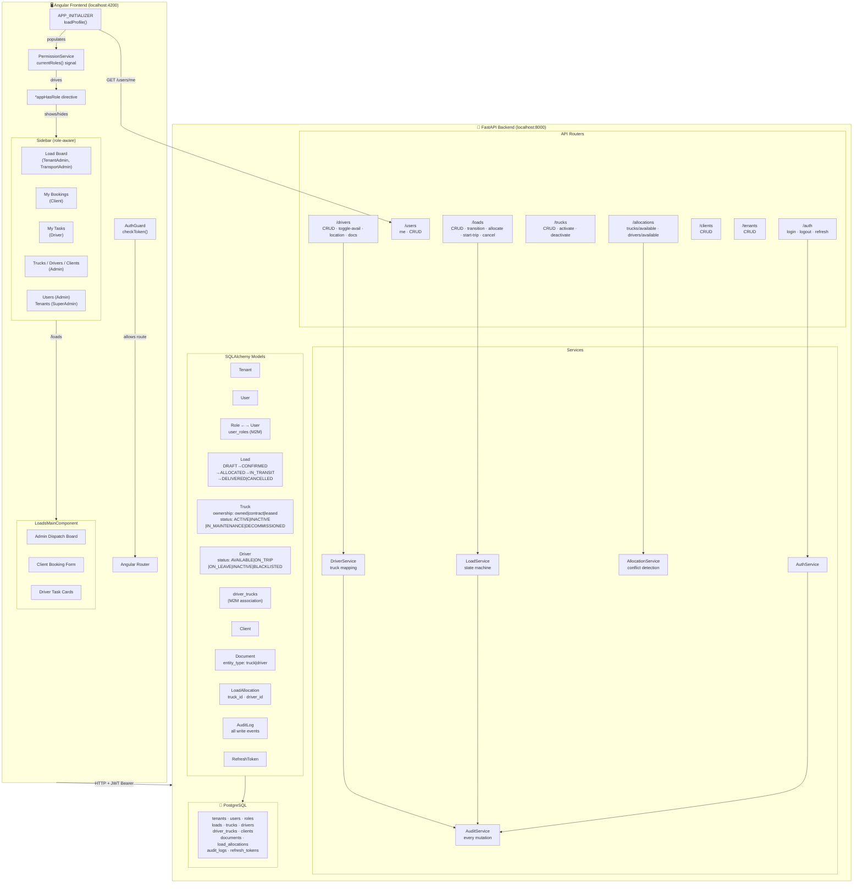
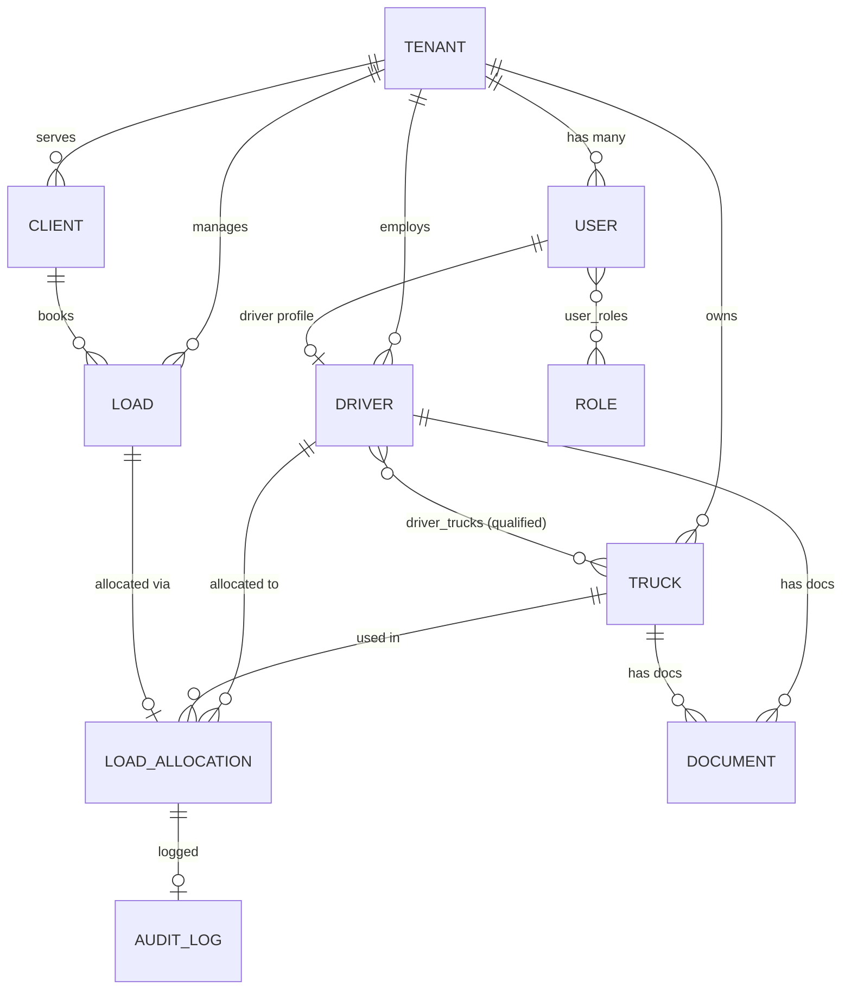
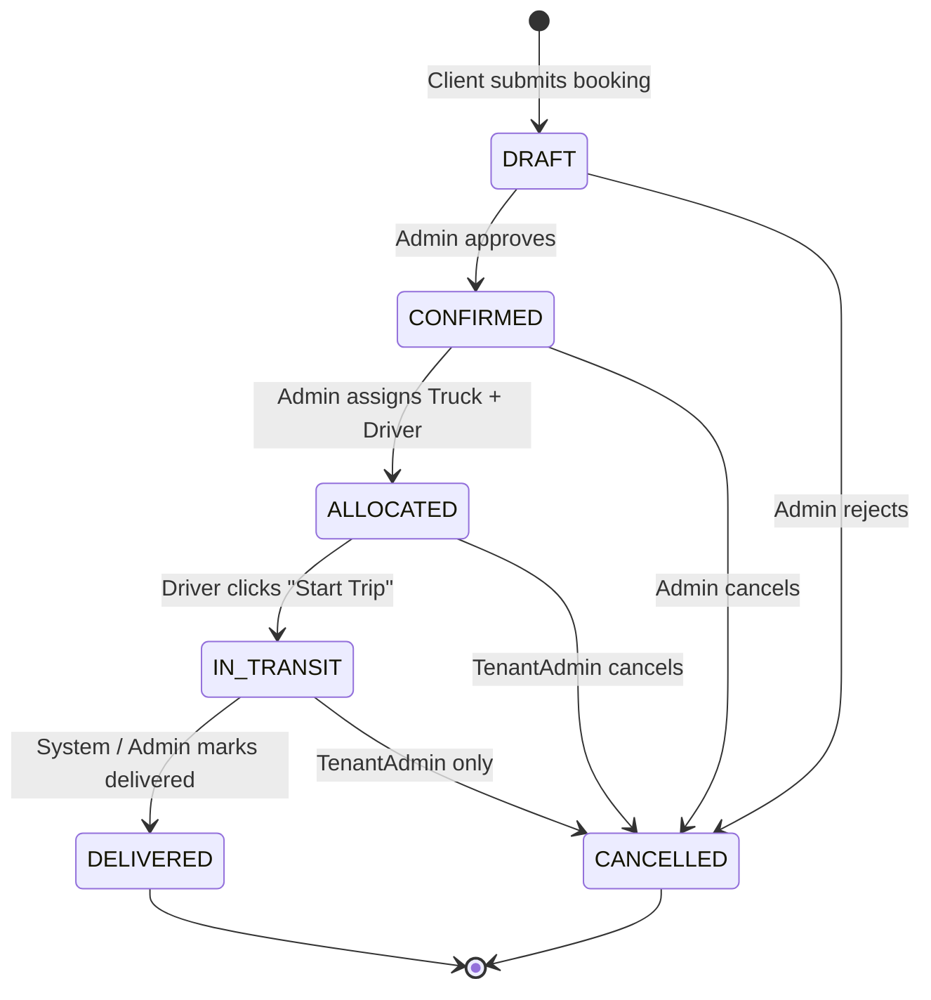

# Transport & Load Management — Knowledge Graph

## System Architecture



---

## Domain Model



---

## Load Lifecycle (State Machine)



---

## Role Access Matrix

| Feature | SuperAdmin | TenantAdmin | TransportAdmin | Client | Driver |
|---|:---:|:---:|:---:|:---:|:---:|
| Create Tenant | ✅ | ❌ | ❌ | ❌ | ❌ |
| Manage Users | ❌ | ✅ | Limited | ❌ | ❌ |
| Manage Trucks | ✅ | ✅ | ✅ | ❌ | ❌ |
| Manage Drivers | ✅ | ✅ | ✅ | ❌ | ❌ |
| Manage Clients | ✅ | ✅ | ✅ | ❌ | ❌ |
| View Load Board | ✅ | ✅ | ✅ | ❌ | ❌ |
| Approve / Reject Load | ✅ | ✅ | ✅ | ❌ | ❌ |
| Allocate Truck + Driver | ✅ | ✅ | ✅ | ❌ | ❌ |
| Submit Booking | ❌ | ❌ | ❌ | ✅ | ❌ |
| View My Bookings | ❌ | ❌ | ❌ | ✅ | ❌ |
| View My Tasks | ❌ | ❌ | ❌ | ❌ | ✅ |
| Start Trip | ❌ | ❌ | ❌ | ❌ | ✅ |
| Update Own Location | ❌ | ❌ | ❌ | ❌ | ✅ |

---

## Key Design Decisions

| Decision | Rationale |
|---|---|
| **Row-level tenant isolation** | Every model carries `tenant_id`; all queries are scoped by it |
| **JWT + Refresh Token** | Short-lived access tokens (stored in memory); refresh tokens persisted in DB |
| **Signals for auth state** | Angular signals (`currentUser`, `isAuthenticated`) are reactive; no NgRx needed |
| **APP_INITIALIZER for profile** | `loadProfile()` runs before first render — ensures roles are populated even on hard refresh |
| **Soft delete everywhere** | `is_deleted` flag, never hard DELETE; full audit trail preserved |
| **driver_trucks M2M** | A driver qualifies for multiple trucks; one truck can have multiple qualified drivers |
| **State machine for loads** | All status transitions validated server-side; UI just reflects backend state |
| **Alembic migrations** | Every schema change is versioned; `down_revision` chain is explicit |

---

## File Structure (Key Paths)

```
apps/
├── admin-frontend/src/app/
│   ├── app.config.ts              ← APP_INITIALIZER (refresh fix)
│   ├── app.routes.ts              ← /loads, /trucks, /drivers, /users, /tenants
│   ├── core/
│   │   ├── auth/
│   │   │   ├── auth.service.ts    ← login, loadProfile, logout
│   │   │   ├── permission.service.ts  ← currentRoles(), hasAnyRole()
│   │   │   └── token.service.ts
│   │   └── guards/auth.guard.ts
│   ├── shared/
│   │   └── directives/has-role.directive.ts  ← *appHasRole
│   ├── layouts/admin-layout/      ← Sidebar with role-aware nav
│   └── features/
│       ├── loads/
│       │   ├── loads-main/        ← Single component, 3 role views
│       │   ├── allocate-dialog/   ← Admin truck+driver picker
│       │   └── services/load.service.ts
│       ├── trucks/                ← Admin CRUD
│       ├── drivers/               ← Admin CRUD
│       ├── clients/               ← Admin CRUD
│       ├── admin/
│       │   ├── tenants/           ← SuperAdmin only
│       │   └── users/             ← TenantAdmin / TransportAdmin
│       └── auth/login/
└── backend/app/
    ├── models/
    │   ├── driver.py              ← driver_trucks M2M, base_location, GPS
    │   └── truck.py               ← qualified_drivers back-ref
    ├── schemas/driver.py          ← DriverLocationUpdate, AssignedTruckBasic
    ├── services/driver_service.py ← truck mapping sync, update_location
    ├── api/v1/drivers.py          ← PATCH /drivers/{id}/location
    └── alembic/versions/
        ├── 20260312_driver_enhancements.py
        └── 20260312_truck_ownership_fields.py
```
