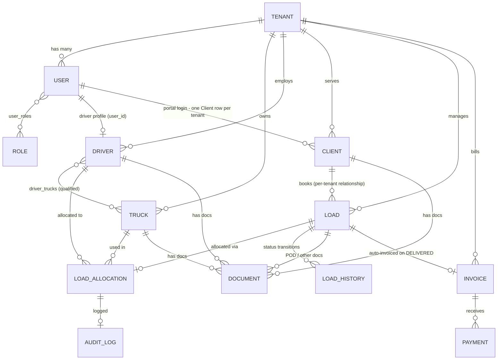
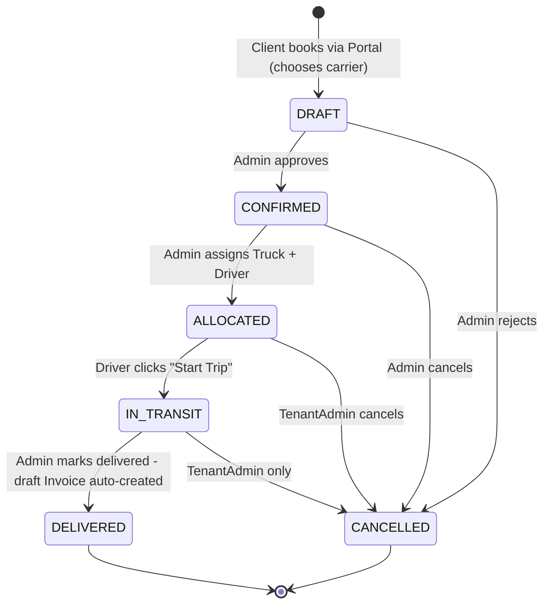
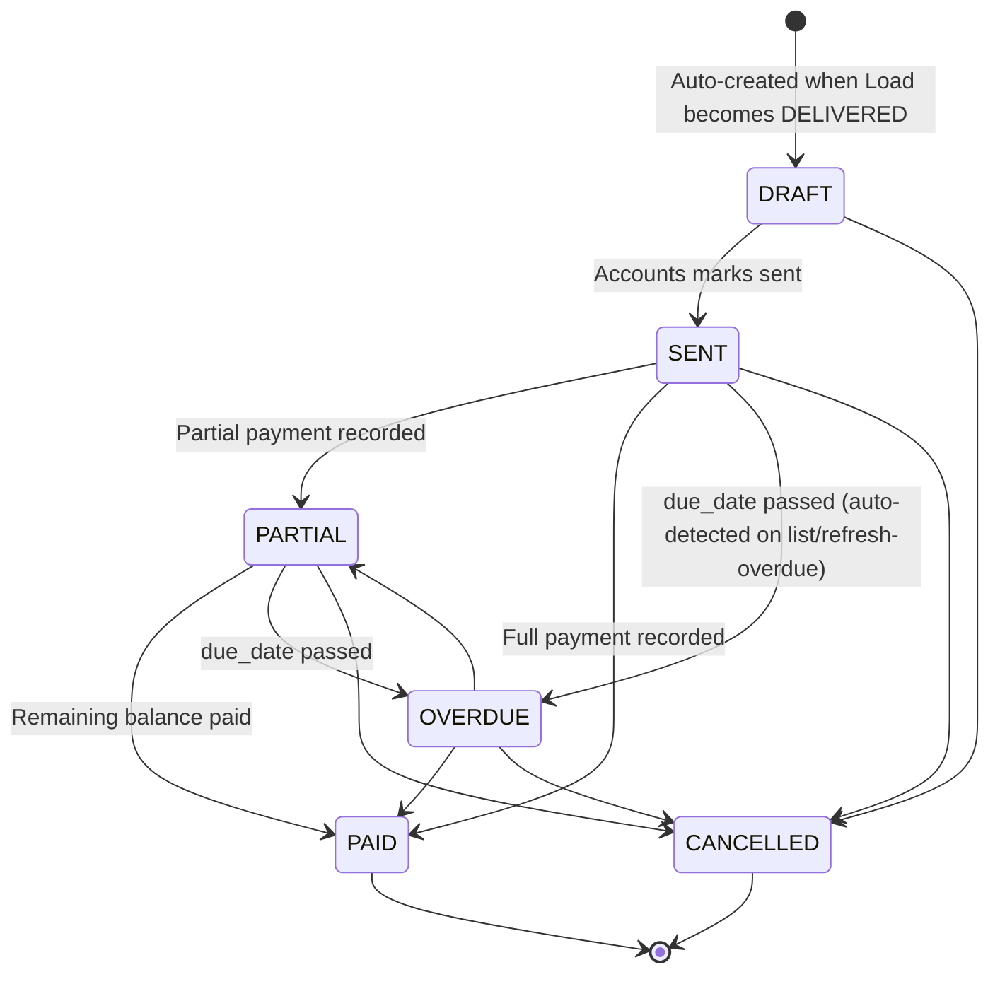

# Transport & Load Management — Knowledge Graph

> Reflects Phases 1–11 (✅ complete) plus the "Recent Platform Improvements"
> (Load Board filters/pagination, Forgot/Reset Password, Audit Log viewer,
> Client Portal "My Invoices") and the Phase 14 Flutter driver-app UI shell
> (`apps/driver-mobile/`, mock data — see `mobile_app_design.md`). See
> `README.md` → "Project Status" for the phase-by-phase changelog and Phase
> 12/13/15 roadmap (white-label branding, 2FA, live GPS tracking).

## System Architecture

```mermaid
graph TB
    subgraph FRONTEND["🖥️ Angular Frontend (localhost:4200)"]
        AppInit["APP_INITIALIZER\nloadProfile()"]
        AuthGuard["authGuard\ncheckToken()"]
        RoleGuard["roleGuard\ndata.roles"]
        HomeGuard["homeRedirectGuard\nClient → /portal, else → /loads"]
        PermSvc["PermissionService\ncurrentRoles() signal"]
        HasRole["*appHasRole directive"]
        Router["Angular Router"]

        AppInit -->|populates| PermSvc
        AuthGuard --> RoleGuard --> Router
        Router -->|'' route| HomeGuard
        PermSvc -->|drives| HasRole
        HasRole -->|shows/hides| SideNav

        subgraph SideNav["Admin Sidebar (role-aware)"]
            S1["Load Board\n(SuperAdmin/TenantAdmin/TransportAdmin)\nsearch · status/client/date filters · paginator"]
            S3["My Tasks\n(Driver)"]
            S4["Trucks / Drivers / Clients\n(Admin)"]
            S5["Users (Admin) · Tenants (SuperAdmin)"]
            S6["Invoices\n(Accounts/Admin)"]
            S7["Reports Dashboard\n(Admin/Accounts)"]
            S8["Audit Log\n(SuperAdmin/TenantAdmin)\nfilters + detail dialog"]
        end

        subgraph LoadsMain["LoadsMainComponent"]
            AdminView["Admin Dispatch Board\nApprove · Allocate · Cancel · Upload POD"]
            DriverView["Driver Task Cards\nStart Trip"]
        end

        subgraph PortalApp["Customer Portal (/portal/*, Client role only)"]
            PortalLayout["PortalLayoutComponent\ncompany name from carriers[0]"]
            ShipmentList["ShipmentListComponent\nMy Shipments + New Booking\n(Carrier picker)"]
            ShipmentDetail["ShipmentDetailComponent\nTimeline + Documents (POD)"]
            InvoiceList["PortalInvoiceListComponent\nMy Invoices (multi-carrier, PDF)"]
        end

        subgraph AuthApp["Auth (/auth/*)"]
            Login["LoginComponent"]
            ForgotPw["ForgotPasswordComponent\n(dev: shows reset link if DEBUG)"]
            ResetPw["ResetPasswordComponent"]
        end

        SideNav -->|/loads| LoadsMain
        PortalLayout --> ShipmentList --> ShipmentDetail
        PortalLayout --> InvoiceList
        Login -.->|Forgot password?| ForgotPw -.-> ResetPw
    end

    subgraph MOBILE["📱 apps/driver-mobile (Flutter, Phase 14)"]
        FlutterApp["UI shell — 10 screens, light/dark theme,\nRiverpod + GoRouter, mock data\n(NOT yet wired to backend)"]
    end

    subgraph BACKEND["🐍 FastAPI Backend (localhost:8000)"]
        subgraph API["API Routers (api/v1)"]
            AuthR["/auth\nlogin · refresh · logout\nforgot-password · reset-password"]
            UsersR["/users\nme · CRUD · timezones · client_id link"]
            LoadsR["/loads\nCRUD · transition · allocate · start-trip\ncancel · documents (POD)"]
            TrucksR["/trucks\nCRUD · activate · deactivate"]
            DriversR["/drivers\nCRUD · toggle-avail · location · docs"]
            ClientsR["/clients\nCRUD · documents\nlink/unlink-portal-account"]
            TenantsR["/tenants\nCRUD"]
            AllocR["/allocations\ntrucks/available · drivers/available"]
            InvoicesR["/invoices\nCRUD · transition · payments\npdf · refresh-overdue"]
            ReportsR["/reports\nsummary · trends · revenue\ndriver/truck performance"]
            PortalR["/portal\nme · loads · invoices\n(multi-carrier aggregation)"]
            AuditR["/audit-logs\nlist · detail\nuser_email + start/end_date filters"]
        end

        subgraph Services["Services"]
            AuthSvc["AuthService"]
            LoadSvc["LoadService\nstate machine + history\n+ Client/Driver ownership scoping"]
            AllocSvc["AllocationService\nconflict detection"]
            DriverSvc["DriverService\ntruck mapping"]
            ClientSvc["ClientService\nlink_portal_account()\n(cross-tenant by email)"]
            InvoiceSvc["InvoiceService\nPDF gen · overdue refresh"]
            ReportSvc["ReportService"]
            DocSvc["DocumentService\nentity_type incl. LOAD"]
            AuditSvc["AuditService\nevery mutation"]
        end

        subgraph Models["SQLAlchemy Models"]
            Tenant["Tenant"]
            User["User\ntimezone (display)"]
            Role["Role ←→ User\nuser_roles (M2M)"]
            Load["Load\nDRAFT→CONFIRMED\n→ALLOCATED→IN_TRANSIT\n→DELIVERED|CANCELLED"]
            LoadHist["LoadHistory\nimmutable transition trail"]
            Truck["Truck\nownership: owned|contract|leased"]
            Driver["Driver\nstatus: AVAILABLE|ON_TRIP\n|ON_LEAVE|INACTIVE|BLACKLISTED"]
            DriverTruck["driver_trucks (M2M)"]
            Client["Client\nuser_id UNIQUE per (tenant_id, user_id)\n— one shipper, many carriers"]
            Document["Document\nentity_type: truck|driver|client|load\ndocument_type incl. POD"]
            Allocation["LoadAllocation\ntruck_id · driver_id"]
            Invoice["Invoice\ndraft→sent→partial/paid/overdue\n→cancelled"]
            Payment["Payment\nagainst Invoice"]
            AuditLog["AuditLog\nall write events\n(+ user_email via joinedload)"]
            RefreshTok["RefreshToken"]
            ResetTok["PasswordResetToken\nsingle-use, 1h TTL\n(hashed via hash_token())"]
        end

        subgraph DB["🐘 PostgreSQL"]
            Tables["tenants · users · roles · user_roles\nloads · load_history · trucks · drivers\ndriver_trucks · clients · documents\nload_allocations · invoices · payments\naudit_logs · refresh_tokens · password_reset_tokens"]
        end

        AuthR --> AuthSvc
        LoadsR --> LoadSvc
        AllocR --> AllocSvc
        DriversR --> DriverSvc
        ClientsR --> ClientSvc
        InvoicesR --> InvoiceSvc
        ReportsR --> ReportSvc
        PortalR -->|"per linked Client,\nresolved across tenants"| LoadSvc
        PortalR -->|"per linked Client"| InvoiceSvc
        AuditR --> AuditSvc
        LoadSvc -->|"on DELIVERED"| InvoiceSvc
        AuthSvc -->|"forgot/reset password"| ResetTok
        AuthSvc --> AuditSvc
        LoadSvc --> AuditSvc
        DriverSvc --> AuditSvc
        ClientSvc --> AuditSvc
        InvoiceSvc --> AuditSvc
        Models --> DB
    end

    FRONTEND -->|"HTTP + JWT Bearer\n(LocalDateTime fields rendered\nin User.timezone)"| BACKEND
    AppInit -->|GET /users/me| UsersR
    MOBILE -.->|"planned — needs driver\nself-service endpoints,\nsee mobile_app_design.md"| BACKEND
```



---

## Domain Model



**Multi-carrier shipper identity** (Phase 11 follow-up): a `Client` row is the
*relationship* between one shipper login (`User`, role `Client`) and one tenant
(carrier) — `company_name`, `credit_limit`, etc. can differ per relationship. The
same `user_id` may appear on `Client` rows in several tenants (unique per
`(tenant_id, user_id)`, not globally). `/portal/*` resolves **all** of a shipper's
`Client` rows via `ClientRepository.get_all_by_user_id()` (the one deliberately
cross-tenant query in the codebase) and aggregates shipments across them, tagging
each with `carrier_name`. A TenantAdmin creates a 2nd+ relationship via **"Link
Portal Account"** on the Client form (cross-tenant lookup by email).

---

## Load Lifecycle (State Machine)



Every transition is written via `LoadService.transition_status()` — never a direct
status write — and appends a `LoadHistory` row (`from_status`, `to_status`,
`changed_by`, `remarks`, `changed_at`). The Client portal's "Status Timeline" reads
this trail. On `DELIVERED`, a `DocumentType.POD` upload becomes available
("Upload Proof of Delivery" on the admin Load Board → visible to the linked client
in the portal's Documents card).

---

## Invoice Lifecycle (State Machine)



`InvoiceService.refresh_overdue()` runs at the top of `get_invoices()` — any
`SENT`/`PARTIAL` invoice past `due_date` flips to `OVERDUE` and feeds the Reports
KPI cards (`overdue_invoices_count`/`amount`). PDF export:
`GET /invoices/{id}/pdf` (reportlab).

---

## Role Access Matrix

| Feature | SuperAdmin | TenantAdmin | TransportAdmin | Accounts | Client (Portal) | Driver |
|---|:---:|:---:|:---:|:---:|:---:|:---:|
| Create Tenant | ✅ | ❌ | ❌ | ❌ | ❌ | ❌ |
| Manage Users | ✅ | ✅ | ❌ | ❌ | ❌ | ❌ |
| Manage Trucks / Drivers | ✅ | ✅ | ✅ | ❌ | ❌ | ❌ |
| Manage Clients + Link Portal Account | ✅ | ✅ | ❌ (read-only) | Read-only | ❌ | ❌ |
| View Load Board / Approve / Allocate / Cancel | ✅ | ✅ | ✅ | ❌ | ❌ | ❌ |
| Upload POD | ✅ | ✅ | ✅ | ❌ | ❌ | ❌ |
| Manage Invoices & Payments | ✅ | ✅ | ❌ | ✅ | ❌ | ❌ |
| View Reports Dashboard | ✅ | ✅ | ❌ | ✅ | ❌ | ❌ |
| Customer Portal: My Shipments (multi-carrier) | ❌ | ❌ | ❌ | ❌ | ✅ | ❌ |
| Customer Portal: Submit Booking (choose carrier) | ❌ | ❌ | ❌ | ❌ | ✅ | ❌ |
| Customer Portal: View Status Timeline + POD | ❌ | ❌ | ❌ | ❌ | ✅ | ❌ |
| Customer Portal: My Invoices (multi-carrier, PDF) | ❌ | ❌ | ❌ | ❌ | ✅ | ❌ |
| View Audit Log | ✅ | ✅ (own tenant) | ❌ | ❌ | ❌ | ❌ |
| View My Tasks / Start Trip | ❌ | ❌ | ❌ | ❌ | ❌ | ✅ |

---

## Key Design Decisions

| Decision | Rationale |
|---|---|
| **Row-level tenant isolation** | Every model carries `tenant_id`; `TenantAwareRepository` scopes all queries. `tenant_id=None` (SuperAdmin) intentionally disables the filter — the only other intentional exception is `ClientRepository.get_all_by_user_id()` for the portal |
| **JWT + Refresh Token** | Short-lived access tokens (stored in memory); refresh tokens persisted in DB |
| **Signals for auth state** | Angular signals (`currentUser`, `isAuthenticated`) are reactive; no NgRx needed |
| **APP_INITIALIZER for profile** | `loadProfile()` runs before first render — ensures roles are populated even on hard refresh |
| **Soft delete everywhere** | `is_deleted` flag, never hard DELETE; full audit trail preserved |
| **driver_trucks M2M** | A driver qualifies for multiple trucks; one truck can have multiple qualified drivers |
| **State machine for loads** | All status transitions validated server-side via `LoadService.transition_status()`; UI just reflects backend state; every transition recorded in `LoadHistory` |
| **State machine for invoices** | `INVOICE_ALLOWED_TRANSITIONS` mirrors the load pattern; overdue is auto-detected on read, not a separate write path |
| **Multi-carrier client identity** | `Client.user_id` unique per `(tenant_id, user_id)`, not globally — one shipper login can have a separate `Client` relationship (and credit terms) per carrier. `/portal/*` aggregates across all of them |
| **Link Portal Account by email** | The only sanctioned cross-tenant lookup besides SuperAdmin: `UserRepository.get_by_email()` (already cross-tenant, used for login) lets a TenantAdmin attach an existing Client-role login to their own `Client` record |
| **Per-user display timezone** | `LocalDateTime` (Annotated + `PlainSerializer`) renders `datetime` fields using `User.timezone` via a request-scoped `ContextVar`, falling back to `DEFAULT_TIMEZONE`. Storage is always UTC via `utc_now()` |
| **Lenient login email format** | `UserEmail` (structural `local@domain.tld` check) instead of `pydantic.EmailStr` for `User.email`/login/admin_email — `EmailStr` rejects special-use TLDs like `.local`, which would lock out the seeded SuperAdmin |
| **Forgot/reset password without email service** | `PasswordResetToken` (mirrors `RefreshToken`: hashed, single-use, 1h TTL). `POST /auth/forgot-password` always returns the same generic message (no enumeration); `reset_token` is included in the response only when `settings.DEBUG=True`, and `reset_password()` revokes all of the user's refresh tokens |
| **Alembic migrations** | Every schema change is versioned; `down_revision` chain is explicit. Postgres ENUM `ADD VALUE` is **not** autogenerated — hand-write `with op.get_context().autocommit_block(): op.execute(...)` |

---

## File Structure (Key Paths)

```
apps/
├── admin-frontend/src/app/
│   ├── app.config.ts              ← APP_INITIALIZER (refresh fix)
│   ├── app.routes.ts              ← /loads (admin+driver), /portal/* (Client),
│   │                                  homeRedirectGuard on '' route
│   ├── core/
│   │   ├── auth/
│   │   │   ├── auth.service.ts    ← login, loadProfile, logout
│   │   │   ├── permission.service.ts  ← currentRoles(), hasAnyRole()
│   │   │   └── token.service.ts
│   │   └── guards/
│   │       ├── auth.guard.ts · role.guard.ts
│   │       └── home-redirect.guard.ts   ← Client → /portal, else → /loads
│   ├── shared/
│   │   ├── directives/has-role.directive.ts  ← *appHasRole
│   │   └── components/data-table/      ← 'date' | 'datetime' column types
│   ├── layouts/
│   │   ├── admin-layout/          ← Sidebar with role-aware nav
│   │   └── portal-layout/         ← Customer portal shell
│   └── features/
│       ├── loads/
│       │   ├── loads-main/        ← Admin dispatch board (filters + paginator) + Driver task cards
│       │   ├── allocate-dialog/   ← Admin truck+driver picker
│       │   ├── pod-upload-dialog/ ← Upload Proof of Delivery
│       │   └── services/load.service.ts
│       ├── portal/                ← Customer portal (Client role)
│       │   ├── shipment-list/     ← My Shipments + New Booking (carrier picker)
│       │   ├── shipment-detail/   ← Timeline + Documents (POD)
│       │   ├── invoice-list/      ← My Invoices (multi-carrier, PDF)
│       │   └── services/portal.service.ts
│       ├── invoices/              ← Invoice list/detail, PDF download, payments
│       ├── reports/                ← Reports dashboard (KPIs incl. overdue)
│       ├── trucks/ · drivers/ · clients/  ← Admin CRUD (clients: link-portal-account)
│       ├── admin/
│       │   ├── tenants/           ← SuperAdmin only
│       │   ├── users/             ← TenantAdmin / TransportAdmin (timezone, client_id)
│       │   └── audit-logs/        ← SuperAdmin/TenantAdmin: filters + detail dialog
│       └── auth/
│           ├── login/
│           ├── forgot-password/   ← shows dev reset link when DEBUG=true
│           └── reset-password/
└── backend/app/
    ├── api/v1/
    │   ├── portal.py              ← Client-only, multi-carrier aggregation (loads + invoices)
    │   ├── invoices.py            ← transitions, payments, /pdf, /refresh-overdue
    │   ├── reports.py             ← summary/trends/revenue/performance
    │   ├── clients.py             ← link/unlink-portal-account
    │   ├── auth.py                ← login/refresh/logout + forgot/reset-password
    │   └── audit_logs.py          ← list/detail, user_email, start/end_date filters
    ├── core/
    │   ├── datetime_utils.py      ← utc_now(), format_for_display()
    │   ├── timezone_context.py    ← ContextVar for LocalDateTime
    │   └── security.py            ← hash_password/verify, hash_token (reset tokens too)
    ├── models/
    │   ├── client.py              ← user_id, uq_clients_tenant_user_id
    │   ├── invoice.py             ← Invoice, Payment, INVOICE_ALLOWED_TRANSITIONS
    │   ├── load.py                ← Load, LoadHistory, ALLOWED_TRANSITIONS
    │   └── password_reset_token.py
    ├── schemas/
    │   ├── common.py              ← LocalDateTime, UserEmail, validate_password_complexity
    │   └── portal.py              ← PortalCarrierLink/ProfileResponse, PortalInvoiceResponse
    ├── services/
    │   ├── invoice_pdf.py         ← reportlab PDF generation
    │   ├── client_service.py      ← link_portal_account() / unlink_portal_account()
    │   └── auth_service.py        ← request_password_reset() / reset_password()
    ├── scripts/
    │   ├── seed_data.py           ← roles + SuperAdmin (admin@system.local)
    │   └── seed_demo.py           ← demo tenant + sample accounts/trucks/drivers/clients
    └── alembic/versions/          ← incl. POD/LOAD enum values, multi-carrier unique
                                       constraint, password_reset_tokens table

apps/driver-mobile/lib/   (Flutter, Phase 14 — UI shell, mock data)
├── core/theme/             ← AppTheme.light()/dark(), Inter font, AppColors
├── core/providers/         ← themeModeProvider (persisted)
├── core/router/            ← GoRouter StatefulShellRoute (bottom nav)
├── shared/{models,data,widgets}/  ← Trip/NotificationItem/DocumentItem + mock_data.dart
└── features/{auth,dashboard,trips,notifications,profile}/screens/
```
